# Structural FEA of PLA Robotic Arm Links (ANSYS Workbench)

Static structural analysis of the three PLA links of a 3-joint robotic arm (designed to be 3D-printed; not yet printed), done in **ANSYS Workbench 2026 R1 (Student)**. Each link was checked under the worst-case load, the results were verified against hand calculations, and a mesh-refinement study was used to tell a real stress peak from a modelling artefact.

> This is the structural-analysis part of my final-year robotic arm project (motor selection, CAD, FEA and dynamic modelling). This repository focuses on the FEA work.

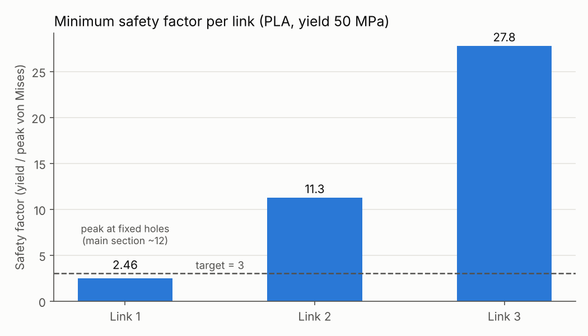

## Key results

| Link | Max deformation | Max von Mises stress | Min safety factor | Reaction force, ANSYS / hand | Result |
|---|---|---|---|---|---|
| Link 1 | 1.43 mm | 20.3 MPa | 2.46 at fixed holes, ~12 in main section | 12.69 / 12.69 N | Main section passes; check holes |
| Link 2 | 0.38 mm | 4.44 MPa | 11.26 | 10.52 / 10.53 N | Pass |
| Link 3 | 0.20 mm | 1.80 MPa | ~28 | 8.36 / 8.37 N | Pass |

* **Reaction forces match hand calculations to within 0.12%**, confirming the loads and supports were applied correctly.
* **Links 2 and 3 pass the safety-factor target of 3** with a large margin.
* **Link 1's peak stress is a stress singularity at the fully fixed holes, not a real peak.** Refining the mesh nearly doubled it (see [Mesh study](#mesh-study)). Its main section sees about 4 MPa, a safety factor of about 12.

## The part

Three flat links carry the servos, with hole patterns for mounting. Modelled in CAD and imported into ANSYS as STEP files.

| Link 1 (150 mm, 53 g) | Link 2 (141 mm, 58 g) | Link 3 (141 mm, 53 g) | Arm layout |
|---|---|---|---|
| 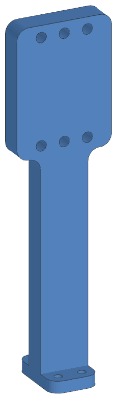 | 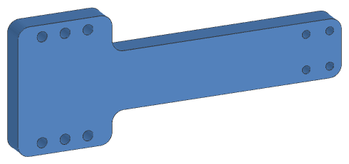 | 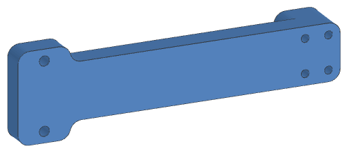 | 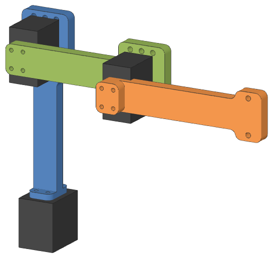 |

Link 1 (blue) stands upright and turns with the base. Link 2 (green, shoulder) and Link 3 (orange, elbow) rotate about the horizontal axis. Grey blocks are simplified servos.

## Analysis setup

**Workflow:** STEP geometry → material (PLA) → mesh → supports and loads → solve → verify reaction force → post-process

| Setting | Value |
|---|---|
| Analysis type | Static Structural, each link solved separately |
| Material | Solid PLA, yield strength 50 MPa (typical assumed value) |
| Mesh | 2 mm global element size (0.5 mm local refinement for the mesh study) |
| Load case | Worst case: arm fully stretched out, 300 g payload + 100 g gripper allowance |
| Gravity | −Y |
| Load factor | Applied loads include a **2× safety factor** |
| Design target | Safety factor ≥ 3, because the links are intended for 3D printing in PLA |

**Boundary conditions**

| Link | Fixed support | Loaded holes | Force Y (N) | Moment Z (N·mm) |
|---|---|---|---|---|
| Link 1 | 4 small holes | 6 large holes | −12.17 | −2726 |
| Link 2 | 4 small holes | 6 large holes | −9.96 | +1546 |
| Link 3 | 4 small holes | 2 large holes | −7.85 | +549 |

Loads and moments come from a hand calculation of the weight of the downstream links, servos, gripper and payload, with the arm horizontal.

## Results

### Link 1: most heavily loaded
| Total deformation (max 1.43 mm) | Equivalent (von Mises) stress (max 20.3 MPa) |
|---|---|
| 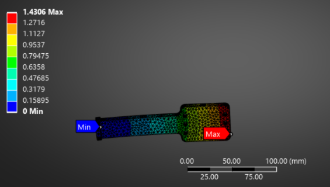 | 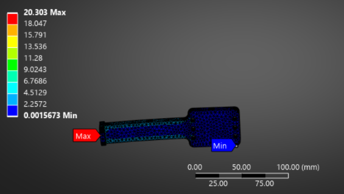 |

### Link 2
| Total deformation (max 0.38 mm) | Equivalent stress (max 4.44 MPa) |
|---|---|
| 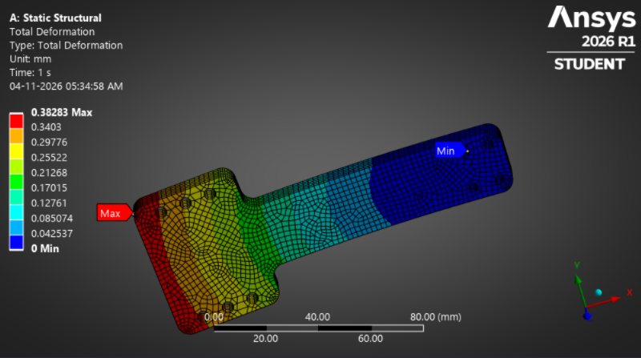 | 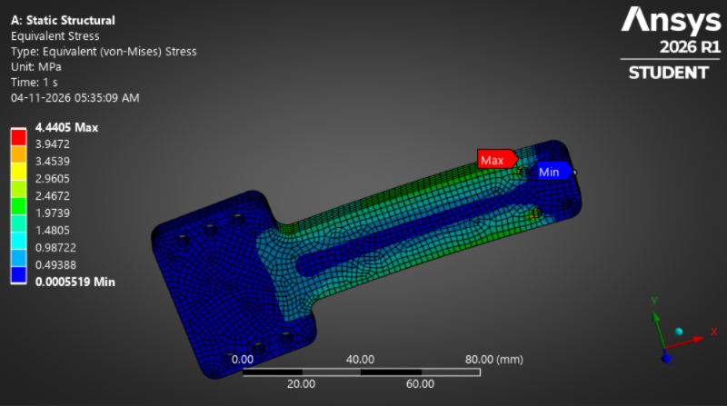 |

Stress concentrates where the narrow section begins, as expected from the change in cross-section.

### Link 3: most lightly loaded
| Total deformation (max 0.20 mm) | Equivalent stress (max 1.80 MPa) |
|---|---|
| 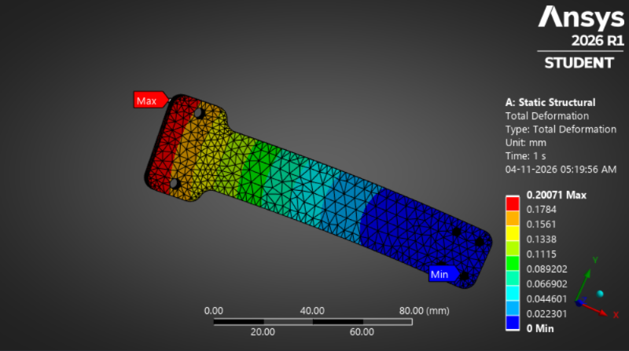 | 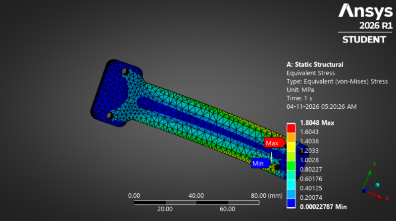 |

ANSYS caps its displayed safety factor at 15, so the value was calculated directly: 50 / 1.80 ≈ 28.

## Mesh study

The Link 1 peak sits right beside the fully fixed holes. To check whether it was real, the same load case was re-solved with the mesh refined from 2 mm to 0.5 mm at the holes:

| 2 mm mesh: peak 6.01 MPa | 0.5 mm at holes: peak 11.75 MPa |
|---|---|
| 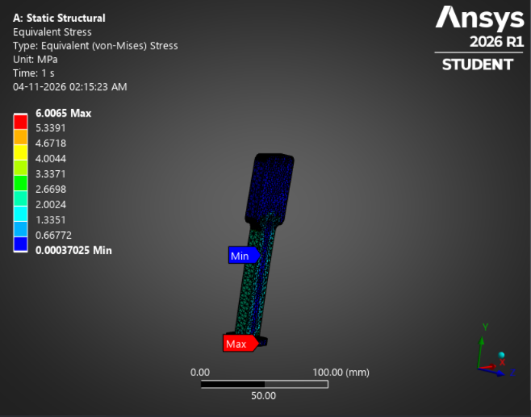 | 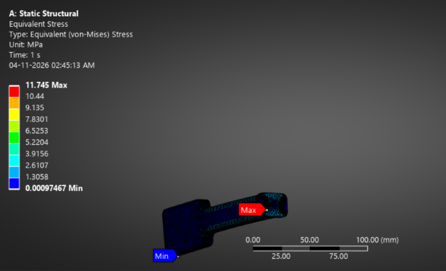 |

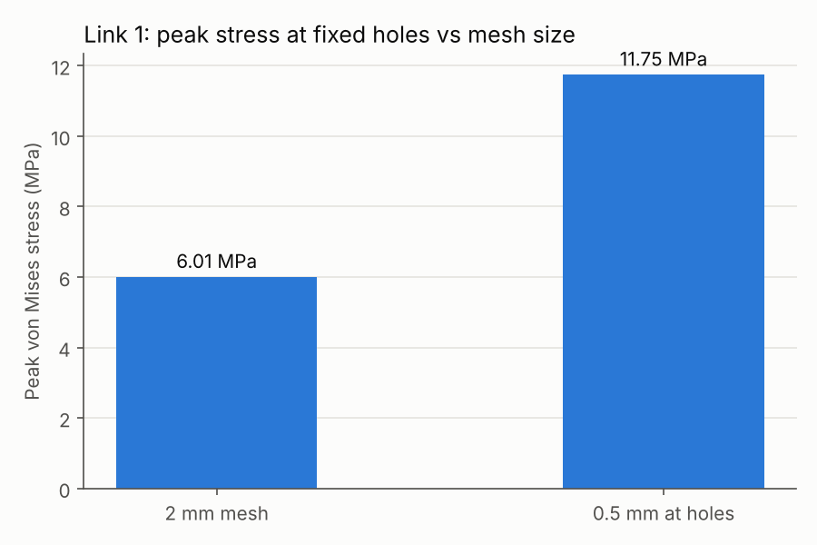

**The peak rose by 96% with refinement and did not converge.** A peak that keeps growing as the mesh gets finer is the signature of a **stress singularity**. Here it is caused by modelling the holes as perfectly rigid fixed supports, which real bolts are not. So the design is judged on the converged main-section stress (~4 MPa, safety factor ~12), and the hole region is flagged for a better bolt model.

*(The mesh study used an earlier practice load; the final load gives the 20.3 MPa peak shown above.)*

## Verification

[`analysis/verify_fea.py`](analysis/verify_fea.py) re-checks the ANSYS output independently:

1. **Equilibrium:** support reaction = applied load + link self-weight (ΣF<sub>y</sub> = 0)
2. **Safety factor:** yield / peak von Mises, against the target of 3
3. **Mesh sensitivity:** % change in peak stress with refinement
4. Generates the two charts in [`results/`](results)

```bash
cd analysis
pip install -r requirements.txt
python verify_fea.py
```

Output (reaction check):
```
  link  applied_load_N  self_weight_N  hand_reaction_N  ansys_reaction_N  difference_pct
Link 1           12.17          0.520           12.690             12.69           0.001
Link 2            9.96          0.569           10.529             10.52          -0.085
Link 3            7.85          0.520            8.370              8.36          -0.119
```

The raw numbers are in [`analysis/fea_results.csv`](analysis/fea_results.csv) and [`analysis/mesh_study.csv`](analysis/mesh_study.csv).

## Engineering takeaways

* **Always check the reaction force.** It is the quickest way to confirm the loads and supports are what you intended.
* **Don't trust a single peak value.** A hotspot at a fixed support or sharp corner must be checked with mesh refinement before it drives a design change.
* **Judge the design where results converge.** Link 1 is safe in its main section; the hole region needs a more realistic bolt model.

## Limitations and next steps

* PLA properties are typical assumed values for solid PLA. Once the links are printed, layer lines and infill will make them weaker than this → **print a test sample and measure its strength**.
* Holes modelled as fully fixed → **model bolts and washers** (bolt pretension or contact) to remove the singularity at Link 1.
* The sideways offset between links isn't modelled → **measure it in the assembly and update the loads**.
* The gripper is represented by a 100 g allowance → **update the loads once the gripper is designed**.
* Estimated gripper-end movement of about 2 mm (Link 1 tilt × 310 mm reach) → **include Link 2 and 3 bending and measure on the real arm**.

## Repository structure

```
├── README.md
├── analysis/
│   ├── fea_results.csv        # loads and ANSYS results per link
│   ├── mesh_study.csv         # Link 1 mesh refinement
│   ├── verify_fea.py          # equilibrium, safety factor and mesh checks + charts
│   └── requirements.txt
├── images/
│   ├── cad/                   # CAD renders
│   ├── ansys/                 # deformation and von Mises contour plots
│   └── mesh_study/            # Link 1 at 2 mm and 0.5 mm mesh
└── results/                   # charts generated by verify_fea.py
```

## Tools

ANSYS Workbench 2026 R1 Student (Static Structural) · CAD (STEP) · Python (pandas, Matplotlib)

## Author

**Bipasha Deka**
B.Tech Mechanical Engineering, Tezpur University
[GitHub](https://github.com/bipashadeka) · [LinkedIn](https://www.linkedin.com/in/bipasha-deka/)
